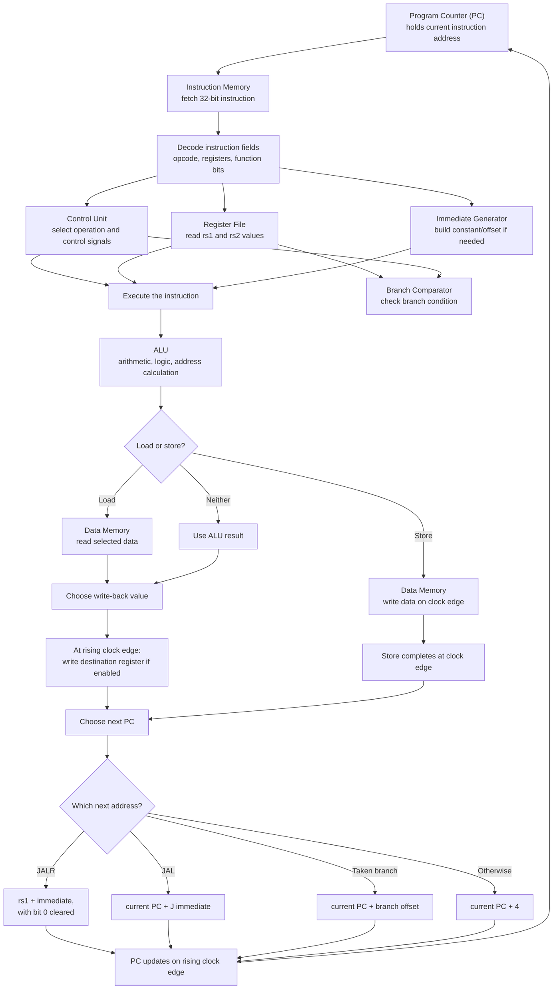

# RV32I Processor

A **32-bit RISC-V processor built in Verilog**, designed to make the journey from an instruction to its result easy to understand.

This project brings together instruction fetching, decoding, arithmetic, memory access, branching, and register write-back in one compact design.


> **New to Verilog?** Start with the [Verilog Syntax Guide](VERILOG_GUIDE.md). It explains the syntax and concepts used in this project in plain language, with examples.

## Contents

- [What this project does](#what-this-project-does)
- [How one instruction moves through the processor](#how-one-instruction-moves-through-the-processor)
- [A worked example: ADD](#a-worked-example-add)
- [How the next instruction is chosen](#how-the-next-instruction-is-chosen)
- [Instruction support](#instruction-support)
- [Project layout](#project-layout)
- [Run a simulation](#run-a-simulation)
- [Testbenches](#testbenches)
- [Current scope and limitations](#current-scope-and-limitations)
- [Development workflow](#development-workflow)
- [Learn the Verilog used here](#learn-the-verilog-used-here)

## What this project does

The design is a compact, single-cycle-style processor datapath. The main calculations happen between clock edges, and state such as the program counter and register-file contents is updated on a rising clock edge.

The processor fetches 32-bit instructions from `programs/instructions.mem`, executes supported instructions, and updates registers or data memory as required. Its control-flow logic supports conditional branches and jumps.

Each major job has a separate Verilog module. That makes the project easier to read, test, explain, and extend.

## How one instruction moves through the processor

An instruction is a 32-bit value that tells the processor what to do. The processor interprets that value, gathers the required data, performs the operation, and decides what address to fetch next.

The flowchart below shows the main path. Some work happens in parallel: for example, the control unit decodes the instruction while the register file and immediate generator prepare values. Not every instruction uses every block.



### The main parts in plain language

| Part | Its job |
| --- | --- |
| **Program Counter (PC)** | Remembers the address of the current instruction. |
| **Instruction Memory** | Finds the instruction stored at that address. |
| **Control Unit** | Recognizes the instruction and tells the other blocks what to do. |
| **Register File** | Holds the processor's 32 general-purpose registers, `x0` through `x31`. |
| **Immediate Generator** | Extracts a number or offset packed inside an instruction and expands it to 32 bits. |
| **ALU** | Performs arithmetic and bit operations, and calculates addresses. |
| **Branch Comparator** | Checks conditions such as equal, not equal, less than, and greater than or equal. |
| **Data Memory** | Holds data that load and store instructions read or write. |
| **Write-back selection** | Chooses which value, if any, should be written to a destination register. |

### What does “one cycle” mean here?

Most calculation and selection logic reacts to the current signals during the cycle. On the rising edge of the clock, the PC and any enabled register-file or data-memory writes update. The new PC then points to the instruction for the next cycle.

A store changes data memory at the clock edge but does not write a general-purpose register. A branch usually does not write a register; it affects which PC value is selected. Loads write the value read from data memory. Most arithmetic instructions write the ALU result.

## A worked example: `ADD x3, x1, x2`

The first entry in `programs/instructions.mem` is:

```text
002081B3  // ADD x3, x1, x2
```

It means: **add the value in register `x1` to the value in register `x2`, then save the result in `x3`.**

The current top-level smoke test seeds `x1 = 20` and `x2 = 3` directly from the testbench so the example has known starting values.

| Step | What happens | Value in this example |
| --- | --- | --- |
| 1. Fetch | PC is 0, so instruction memory returns the first instruction. | Instruction = `002081B3` |
| 2. Decode | The control unit recognizes an R-type ADD and enables register write-back. | Destination = `x3`; sources = `x1`, `x2` |
| 3. Read | The register file supplies both source values. | `x1 = 20`, `x2 = 3` |
| 4. Execute | The ALU performs addition. | `20 + 3 = 23` |
| 5. Choose result | This is not a load or jump, so the ALU result is selected. | Write-back value = `23` |
| 6. Clock edge | The enabled write stores 23 in `x3`; the PC advances. | `x3 = 23`, next PC = `4` |

The testbench checks whether `x3` becomes 23. If it does not, the test fails. The next instruction is then available at address 4.

The same structure works for other instructions, but the details differ. For example, `LW` calculates a memory address using a base register and an offset, reads data memory, and writes the loaded value to a register instead of writing the ALU's address calculation.

## How the next instruction is chosen

The current design uses this priority when selecting the next PC:

1. **JALR** — Use `rs1 + immediate` as the target, with bit 0 cleared.
2. **JAL** — Use the current PC plus the J-type offset.
3. **Taken conditional branch** — Use the current PC plus the B-type offset when the comparison is true.
4. **Normal flow** — If none of the above applies, use `PC + 4`.

JAL and JALR also save `PC + 4` in their destination register. This value is the return address: it points to the instruction after the jump.

## Instruction support

The control and datapath logic currently covers these instruction groups:

| Group | Instructions | Purpose |
| --- | --- | --- |
| Integer arithmetic and logic | ADD, SUB, SLL, SLT, SLTU, XOR, SRL, SRA, OR, AND | Operate on register values |
| Immediate arithmetic and logic | ADDI, SLLI, SLTI, SLTIU, XORI, SRLI, SRAI, ORI, ANDI | Operate on a register and an immediate |
| Loads | LB, LH, LW, LBU, LHU | Read byte, halfword, or word data |
| Stores | SB, SH, SW | Write byte, halfword, or word data |
| Conditional branches | BEQ, BNE, BLT, BGE, BLTU, BGEU | Choose a path based on a comparison |
| Upper-immediate | LUI, AUIPC | Build an upper constant or add it to the PC |
| Jumps | JAL, JALR | Change control flow and save a return address |

This is a **subset of RV32I**, not a claim that every part of the RISC-V specification is implemented.

## Project layout

```text
.
├── programs/
│   └── instructions.mem      # Program loaded into instruction memory
├── rtl/
│   ├── ALU.v                 # Arithmetic and logic operations
│   ├── BranchComp.v          # Conditional branch comparisons
│   ├── ControlUnit.v         # Instruction decoding and control signals
│   ├── DataMemory.v          # Loads and stores
│   ├── ImmediateGenerator.v  # Builds instruction immediates
│   ├── InstructionMemory.v   # Fetches instructions
│   ├── ProgramCounter.v      # Stores the current instruction address
│   ├── RegisterFile.v        # General-purpose registers
│   └── Top.v                 # Connects the processor modules
├── tb/                       # Testbenches for individual modules and Top
├── README.md                 # Project overview and processor walkthrough
└── VERILOG_GUIDE.md          # Plain-language guide to Verilog syntax
```

Each `*_tb.v` file is a testbench for a module. The top-level testbench is named `Top_tb` inside `tb/top_tb.v`.

## Run a simulation

The examples below use [Icarus Verilog](https://steveicarus.github.io/iverilog/) to compile and run the testbenches. Run commands from the **repository root**, because instruction memory loads `programs/instructions.mem` using a relative path.

### 1. Install the tools

Install Icarus Verilog. GTKWave is optional and can be used to inspect waveforms.

### 2. Create a folder for simulation outputs

```sh
mkdir -p sim
```

### 3. Run a unit test

For example, to test the control unit:

```sh
iverilog -g2012 -s ControlUnit_tb -o sim/control_unit_tb.vvp rtl/ControlUnit.v tb/ControlUnit_tb.v
vvp sim/control_unit_tb.vvp
```

### 4. Run the top-level smoke test

```sh
iverilog -g2012 -s Top_tb -o sim/top_tb.vvp rtl/*.v tb/top_tb.v
vvp sim/top_tb.vvp
```

The current top-level test checks reset, instruction fetch for the first instruction, and the result of an ADD operation. It is a smoke test, not a full run of the program.

### 5. Inspect waveforms (optional)

Testbenches generate `.vcd` waveform files. Open a generated waveform in GTKWave to inspect signals over time. Some testbenches write their waveform directly to the repository root, while others write under `sim/`.

### Available testbenches

| Testbench | Module covered |
| --- | --- |
| `tb/ALU_tb.v` | ALU operations |
| `tb/BranchComp_tb.v` | Branch comparisons |
| `tb/ControlUnit_tb.v` | Control signals, including valid and invalid JALR encodings |
| `tb/DataMemory_tb.v` | Load/store data-memory behavior |
| `tb/ImmediateGenerator_tb.v` | Immediate generation |
| `tb/InstructionMemory_tb.v` | Instruction fetch |
| `tb/ProgramCounter_tb.v` | PC reset and updates |
| `tb/RegisterFile_tb.v` | Register-file behavior |
| `tb/top_tb.v` | Basic processor integration smoke test |

The testbenches are currently run individually; there is not yet a single command that runs the full suite.

## Current scope and limitations

- The processor implements a subset of RV32I. Unsupported encodings do not have a complete architectural exception-handling path.
- JALR clears bit 0 of the calculated target, as the instruction requires. The project does not yet implement instruction-address-misaligned exceptions. The current sample ends with `JALR x20, 0(x21)`; the preceding program sets `x21 = 7`, producing target address 6 after bit 0 is cleared. Address 6 is not 4-byte aligned, so that sample is not yet a valid end-to-end JALR demonstration. A dedicated test should use an aligned target.
- The current top-level testbench does not yet run the complete program or verify JAL/JALR execution end to end.
- Simulation results should not be treated as passing until the relevant testbenches have been run with a Verilog simulator.

## Development workflow

When adding or changing an instruction, use a small repeatable workflow:

1. **Update the RTL** — Make the smallest change in the relevant module or modules.
2. **Add or update a unit test** — Check decoding, immediate generation, ALU behavior, memory access, or comparison as appropriate.
3. **Run the relevant testbench** — Then run the top-level smoke test to catch basic integration problems.
4. **Inspect waveforms when useful** — Follow signals such as PC, instruction, ALU result, and write-back data.
5. **Commit a focused change** — Use a clear commit message and keep unrelated edits separate.
6. **Update documentation** — Keep instruction support, commands, examples, and known limitations accurate.

## Learn the Verilog used here

The companion guide, **[VERILOG_GUIDE.md](VERILOG_GUIDE.md)**, explains the syntax and coding patterns used in this repository, including:

- `wire` versus `reg`
- `assign`, `always @(*)`, and clocked `always @(posedge clk)`
- Blocking `=` versus non-blocking `<=` assignments
- Bit widths, number bases, bit selection, and concatenation
- `if`, `case`, operators, arrays, and loops
- Module instances and named port connections
- Testbenches, clock generation, timing delays, assertions, and waveforms
- A worked explanation of `ADD x3, x1, x2`

The aim is that you can explain not just what a line says, but why it is written that way and how it helps the processor work.

---

Built as a learning-focused Verilog processor project. The design and documentation will evolve together as more instruction behavior and verification are added.
