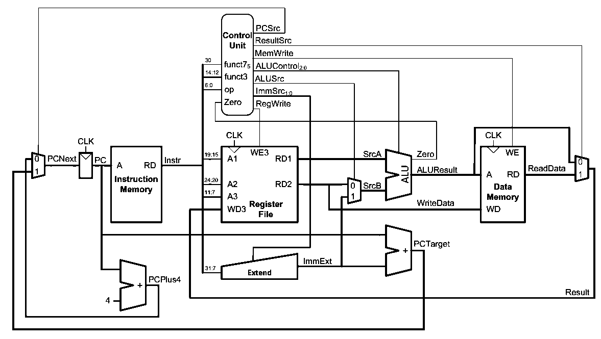
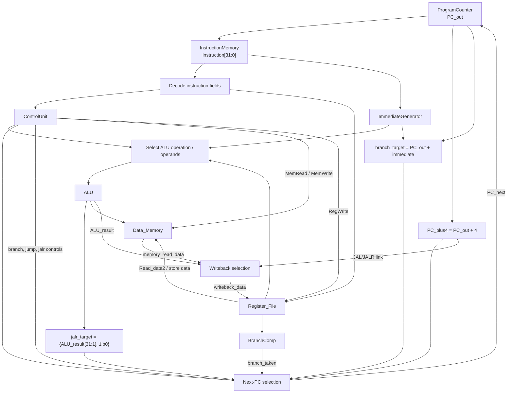

# RV32I Single-Cycle Processor

A 32-bit RISC-V processor subset implemented in Verilog. This project connects instruction fetch, instruction decoding, register reads, ALU execution, data-memory access, register writeback, conditional branches, and jumps in one single-cycle datapath.


> New to Verilog? Start with the [Verilog Syntax Guide](VERILOG_GUIDE.md).

## Contents

- [Architecture overview](#architecture-overview)
- [Instruction workflow](#instruction-workflow)
- [Control flow](#control-flow)
- [Instruction support](#instruction-support)
- [Project structure](#project-structure)
- [Run the simulations](#run-the-simulations)
- [Test coverage](#test-coverage)

## Architecture overview

The top-level module is **Top** in **rtl/Top.v**. It connects the modules below.

| Module | Responsibility |
| --- | --- |
| **ProgramCounter** | Holds PC_out and updates it with PC_in on a rising clock edge; reset sets the PC to zero. |
| **InstructionMemory** | Fetches the 32-bit instruction at the current PC from programs/instructions.mem. |
| **ControlUnit** | Decodes the opcode and function fields and generates control signals. |
| **Register_File** | Provides two asynchronous register reads and a synchronous write port. Register x0 always reads as zero and ignores writes. |
| **ImmediateGenerator** | Builds sign-extended or shifted immediates for I, S, B, U and J instruction formats. |
| **ALU** | Performs arithmetic, logical, shift, and signed/unsigned comparison operations. It also calculates load/store addresses. |
| **BranchComp** | Compares source-register values for BEQ, BNE, BLT, BGE, BLTU and BGEU. |
| **Data_Memory** | Supports byte, halfword and word loads and stores. |
| **Top** | Integrates the datapath, writeback selection, and next-PC control. |

### Datapath diagram

The repository's datapath illustration is available here:



The 32-bit **instruction** output from InstructionMemory fans out to instruction-field decoding and ImmediateGenerator. The source-register values feed the ALU and BranchComp. The ALU result is used as a load/store address and as a possible writeback value.

## Instruction workflow

The processor is described using five logical stages, but it is **not a five-stage pipeline**. An instruction's combinational datapath runs within one clock cycle; state updates occur at the rising clock edge.



### Stage-by-stage summary

1. **Fetch:** ProgramCounter supplies PC_out; InstructionMemory reads the instruction. PC_plus4 is calculated for sequential execution and jump-link values.
2. **Decode:** instruction fields are extracted; ControlUnit, Register_File, and ImmediateGenerator prepare the required controls and operands.
3. **Execute:** ALU performs the selected operation, calculates effective addresses, and supplies the JALR base-plus-offset result. BranchComp evaluates branch conditions.
4. **Memory:** Data_Memory reads load data or writes store data when enabled.
5. **Register writeback:** the writeback selection supplies ALU_result, memory_read_data, or PC_plus4 for JAL/JALR to the register file.

## Control flow

The current next-PC selection logic in rtl/Top.v uses this priority:

1. **JALR:** jalr_target = {ALU_result[31:1], 1'b0}.
2. **JAL:** branch_target = PC_out + immediate, using the J-type immediate.
3. **Taken conditional branch:** choose branch_target when branch and branch_taken are both true.
4. **Sequential execution:** otherwise choose PC_plus4 = PC_out + 4.

BranchComp supports all six conditional branch instructions: BEQ, BNE, BLT, BGE, BLTU and BGEU. RegWrite enables destination-register updates. Loads select memory_read_data; ordinary arithmetic and logical operations select ALU_result; JAL and JALR write PC_plus4 as their link value.

## Instruction support

The control and datapath logic supports the following instruction groups:

| Group | Instructions |
| --- | --- |
| Register arithmetic and logic | ADD, SUB, SLL, SLT, SLTU, XOR, SRL, SRA, OR, AND |
| Immediate arithmetic and logic | ADDI, SLLI, SLTI, SLTIU, XORI, SRLI, SRAI, ORI, ANDI |
| Loads | LB, LH, LW, LBU, LHU |
| Stores | SB, SH, SW |
| Conditional branches | BEQ, BNE, BLT, BGE, BLTU, BGEU |
| Upper immediate | LUI, AUIPC |
| Jumps | JAL, JALR |

The sample program in programs/instructions.mem exercises arithmetic and logical operations, memory access, LUI/AUIPC, conditional branches, and JALR. InstructionMemory loads this file using $readmemh; edit instruction encodings in that file rather than duplicating them inside a testbench.

## Project structure

```text
.
├── programs/
│   └── instructions.mem       # Instruction program loaded by InstructionMemory
├── rtl/
│   ├── ALU.v
│   ├── BranchComp.v
│   ├── ControlUnit.v
│   ├── DataMemory.v
│   ├── ImmediateGenerator.v
│   ├── InstructionMemory.v
│   ├── ProgramCounter.v
│   ├── RegisterFile.v
│   └── Top.v                  # Complete integrated datapath
├── tb/
│   ├── ALU_tb.v
│   ├── BranchComp_tb.v
│   ├── ControlUnit_tb.v
│   ├── DataMemory_tb.v
│   ├── ImmediateGenerator_tb.v
│   ├── InstructionMemory_tb.v
│   ├── ProgramCounter_tb.v
│   ├── RegisterFile_tb.v
│   └── top_tb.v               # Top-level program run
├── docs/images/
│   └── processor-datapath.png
├── README.md
└── VERILOG_GUIDE.md
```

The file names are DataMemory.v and RegisterFile.v, while their module names are Data_Memory and Register_File.

## Run the simulations

Install [Icarus Verilog](https://steveicarus.github.io/iverilog/). Run all commands from the **repository root** because InstructionMemory loads programs/instructions.mem using a relative path.

### Top-level integration run

The top-level testbench initializes source registers and executes the program through the final JALR instruction.

```bash
mkdir -p sim
iverilog -g2012 -s Top_tb -o sim/top_tb rtl/*.v tb/top_tb.v
vvp sim/top_tb
```

### Individual module testbenches

Run the module testbenches individually:

```bash
mkdir -p sim

iverilog -g2012 -s ALU_tb -o sim/alu_tb rtl/ALU.v tb/ALU_tb.v
vvp sim/alu_tb

iverilog -g2012 -s BranchComp_tb -o sim/branchcomp_tb rtl/BranchComp.v tb/BranchComp_tb.v
vvp sim/branchcomp_tb

iverilog -g2012 -s ControlUnit_tb -o sim/controlunit_tb rtl/ControlUnit.v tb/ControlUnit_tb.v
vvp sim/controlunit_tb

iverilog -g2012 -s DataMemory_tb -o sim/datamemory_tb rtl/DataMemory.v tb/DataMemory_tb.v
vvp sim/datamemory_tb

iverilog -g2012 -s ImmediateGenerator_tb -o sim/immediate_tb rtl/ImmediateGenerator.v tb/ImmediateGenerator_tb.v
vvp sim/immediate_tb

iverilog -g2012 -s InstructionMemory_tb -o sim/instructionmemory_tb rtl/InstructionMemory.v tb/InstructionMemory_tb.v
vvp sim/instructionmemory_tb

iverilog -g2012 -s ProgramCounter_tb -o sim/programcounter_tb rtl/ProgramCounter.v tb/ProgramCounter_tb.v
vvp sim/programcounter_tb

iverilog -g2012 -s RegisterFile_tb -o sim/registerfile_tb rtl/RegisterFile.v tb/RegisterFile_tb.v
vvp sim/registerfile_tb
```

> Run from the repository root so the memory image is found. Testbenches may create VCD waveform files; open them with GTKWave to inspect signals over time.

## Test coverage

The project testbenches cover the core modules and top-level program flow. The project author has run the testbenches and confirmed that they pass.

- **ALU:** arithmetic, logic, shifts, and comparisons.
- **BranchComp:** equality, inequality, signed and unsigned comparisons.
- **ControlUnit:** control-signal decoding for supported instruction groups.
- **Data_Memory:** LB/LH/LW/LBU/LHU and SB/SH/SW behavior.
- **ImmediateGenerator:** I, S, B, U and J immediate construction.
- **InstructionMemory / ProgramCounter / Register_File:** instruction reads, PC updates, register reads/writes, and x0 behavior.
- **Top-level program:** ALU operations, memory instructions, LUI/AUIPC, taken and not-taken branches, skipped instructions, and JALR link/redirect flow.

## Learn the Verilog used here

The companion [VERILOG_GUIDE.md](VERILOG_GUIDE.md) explains the syntax and coding patterns used in this repository, including wires and registers, combinational and clocked always blocks, assignment operators, bit slicing, concatenation, module instantiation, testbenches, clocks, assertions, and waveform debugging.

---

Built as a learning-focused Verilog processor project. The RTL, program image, tests, and documentation are intended to evolve together.
